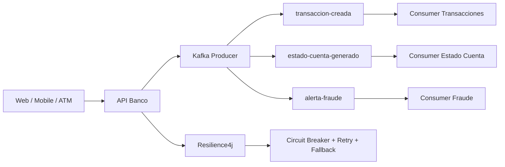

# Arquitectura de eventos - Semana 7

## Patrón seleccionado
Arquitectura orientada a eventos (Event-Driven Architecture) con Kafka. Los productores publican eventos sin acoplarse a los consumidores, permitiendo procesamiento asíncrono y escalado por particiones/grupos de consumidores.

## Evidencias sugeridas
1. `docker compose up -d` mostrando Kafka iniciado.
2. `mvn spring-boot:run` mostrando la aplicación levantada.
3. POST `/api/auth/login` para obtener JWT.
4. POST `/api/eventos/transaccion` con Bearer Token y respuesta HTTP 202.
5. Consola mostrando `Evento procesado [transaccion-creada]`.
6. GET `/api/eventos/resiliencia` mostrando `FALLBACK_ACTIVO`.
